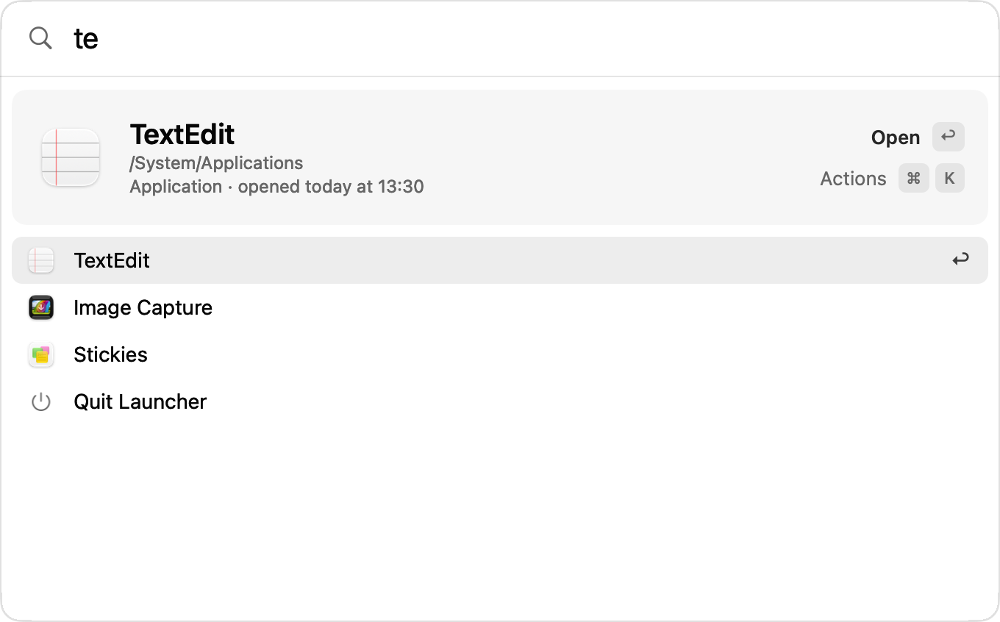
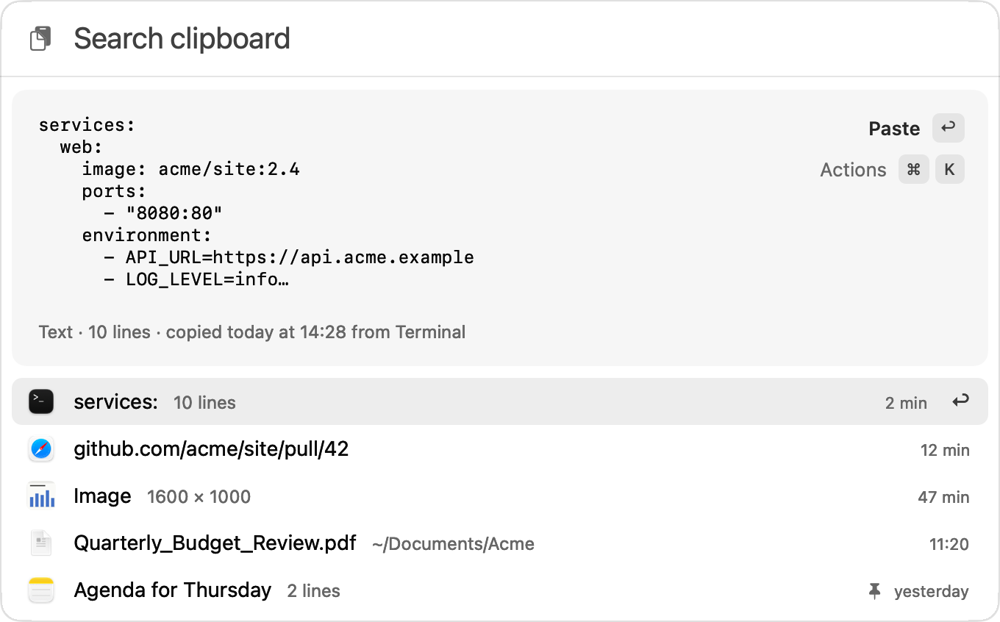
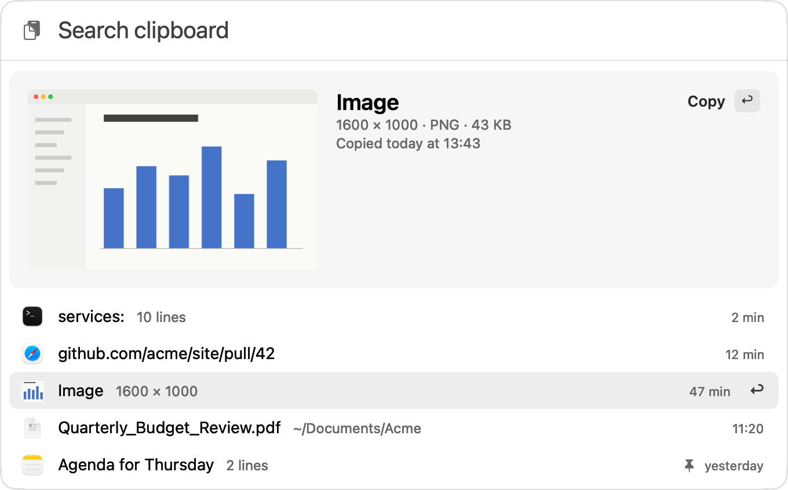

# Pith

**A keyboard-only launcher and clipboard manager for macOS.**

Press ⌘P from any app, type a few letters, press ⏎: apps, files and folders in one ranked list, with their actions on
⌘K. Press ⌘⇧V for everything you've copied. Native AppKit, always resident, and free: no account, no telemetry, no AI.


[](LICENSE)

<p align="center">
  <picture>
    <source media="(prefers-color-scheme: dark)" srcset="docs/snapshots/recent-dark.png">
    
  </picture>
</p>

```sh
curl -fsSL https://pith.edoardobertoli.xyz/install.sh | sh
```

For macOS 26 Tahoe or later on Apple Silicon. Or download [Pith.dmg](https://pith.edoardobertoli.xyz/Pith.dmg); see
[Install](#install).

> Pith: the essential part, and nothing else. It's in active development, and I use it every day.

[Why](#why) · [Features](#features) · [Install](#install) · [Keys](#keys) · [Configuration](#configuration) ·
[Privacy and permissions](#privacy-and-permissions) · [FAQ](#faq) · [Uninstall](#uninstall) ·
[Feedback](#feedback) · [Build from source](#build-from-source) · [License](#license)

## Why

I used Raycast, and I think they did a great job. But all I ever needed was the launcher. I don't need most of the
tools, I'm tired of AI being put into everything, and RAM isn't something I can hand out freely to my programs
anymore.

So this is a launcher for people who need a launcher. Not a whole app environment hidden behind one, built mostly to
justify a subscription.

- **Instant.** Everything is prepared at launch and kept in memory, so ⌘P only shows what's ready.
- **Keyboard only.** The row you want is usually the first.
- **Small.** Native AppKit and Swift, one dependency (Sparkle, for updates), about 0% CPU when idle.
- **Private.** No account, no telemetry, no AI. Your clipboard and files never leave your Mac.
- **Plain.** It follows the system's appearance, and its settings are one text file.

## Features

### Launcher

<table>
  <tr>
    <td width="50%" valign="top">
      <picture>
        <source media="(prefers-color-scheme: dark)" srcset="docs/snapshots/search-dark.png">
        
      </picture>
      <p align="center"><sub><b>Type a few letters, press ⏎</b></sub></p>
    </td>
    <td width="50%" valign="top">
      <picture>
        <source media="(prefers-color-scheme: dark)" srcset="docs/snapshots/actions-dark.png">
        
      </picture>
      <p align="center"><sub><b>⌘K</b>: the actions for what's selected</sub></p>
    </td>
  </tr>
</table>

- **Apps, files and folders** in one list. Every word you type must match, in any order, so `acme deploy` finds
  `deploy.sh` in a folder called Acme. What you open often comes first.
- **Actions on ⌘K:** Open With…, Reveal in Finder, Copy Path, Copy File, Quick Look, Zip, Move to Trash, Open in
  Terminal; Quit and Force Quit for a running app (Force Quit asks for a second ⏎).
- **Files stay current:** they're indexed in memory and updated as they change on disk.
- **Before you type,** it lists what you opened last, the apps that are open, or nothing at all: your choice.
- **No Dock or menu bar icon.** Pith's own commands are in the launcher: Clipboard History, Check for Updates, Open
  Config, Pause Clipboard Recording, Quit Pith.

### Clipboard

<table>
  <tr>
    <td width="50%" valign="top">
      <picture>
        <source media="(prefers-color-scheme: dark)" srcset="docs/snapshots/clipboard-text-dark.png">
        
      </picture>
      <p align="center"><sub><b>⌘⇧V</b>: everything you copied, newest first</sub></p>
    </td>
    <td width="50%" valign="top">
      <picture>
        <source media="(prefers-color-scheme: dark)" srcset="docs/snapshots/clipboard-image-dark.png">
        
      </picture>
      <p align="center"><sub>Images, files and links, each with a preview</sub></p>
    </td>
  </tr>
</table>

- **Everything you copy:** text, rich text, images, files and links, with the app they came from.
- **⏎ pastes** the selected clip into the app you were in. On ⌘K: Copy to Clipboard, Paste as Plain Text, Open Link,
  Reveal in Finder, Save as File, Pin, Delete.
- **Paste next:** each ⌃⌥V pastes the last clip you copied, then the one before it, and so on, without opening
  anything. Stop for 10 seconds, or copy something new, and it starts again from the newest.
- **Search** by the words in a clip or a file's name. Pinned clips come first, and are never dropped.
- **Passwords aren't recorded:** copies that password managers mark as concealed are skipped. Recording can be
  paused from the launcher.
- **Kept for 30 days, up to 2 GB,** whichever comes first; pins don't count. Both are settings.

## Install

Pith needs macOS 26 Tahoe or later, on a Mac with Apple Silicon. It's free.

**In Terminal** (recommended):

```sh
curl -fsSL https://pith.edoardobertoli.xyz/install.sh | sh
```

It downloads Pith, checks that it's signed with Pith's own certificate, copies it into Applications and opens it. A
file downloaded this way isn't marked as coming from the internet, so macOS opens Pith right away. Running it again
replaces Pith and keeps your settings and history.

**With the installer:** download [Pith.dmg](https://pith.edoardobertoli.xyz/Pith.dmg), open it, and drag Pith onto
Applications. Pith isn't notarized by Apple, so macOS stops it the first time you open it: press Done, then in System
Settings → Privacy & Security, scroll down, press Open Anyway and confirm.

Then press **⌘P**. Pith starts at login and updates itself. It asks for a permission only when a feature first needs
it: see [Privacy and permissions](#privacy-and-permissions).

Pith's downloads are on `pith.edoardobertoli.xyz` and in this repository's
[releases](https://github.com/Mediacom99/pith/releases).

## Keys

| Key | What it does |
|---|---|
| ⌘P | Open or close the launcher, from any app |
| ⌘⇧V, or Clipboard History in the launcher (type `c`) | Open the clipboard history; ⌫ on its empty field goes back to the launcher |
| ⌃⌥V | Paste next: the last clip copied, then the one before it at each press, from any app |
| ↑ ↓ or ⌃K ⌃J | Move the selection |
| ⏎ | Open the selected item, run the selected action, or paste the selected clip into the app you were in |
| ⌘K | Show the selected item's actions, or go back to the search |
| ⌘Q ⌘W ⌘E ⌘R ⌘T ⌘Y ⌘U | In ⌘K, run the 1st to 7th action (each row shows its letter) |
| ⎋ | Back one level, or close |
| ⌘Y, or Space with an empty field | Quick Look the selected file |

These are the defaults: every one can be changed in the config, under `[hotkeys]` and `[keys]`.

## Configuration

Pith's settings are in `~/.config/pith/config.toml`; Open Config in the launcher opens it. It's created on the first
launch with every setting at its default and explained, and a saved change applies right away. A mistake shows up as
a row at the top of the launcher, where ⏎ opens the file; until it's fixed, the settings it touches stay as they were.

Updates never touch the file. A setting added in a later version works with its default until you write it in.

```toml
[hotkeys]
launcher = "cmd+p"
clipboard = "cmd+shift+v"   # "" turns it off
paste_next = "ctrl+alt+v"   # the last clip copied, then the one before at each press; "" turns it off

[keys]                      # the keys inside Pith: one, or a list; [] turns one off
up = ["up", "ctrl+k"]
down = ["down", "ctrl+j"]
open = "return"
actions = "cmd+k"
back = "escape"
preview = ["cmd+y", "space"]
run_actions = ["cmd+q", "cmd+w", "cmd+e", "cmd+r", "cmd+t", "cmd+y", "cmd+u"]
to_launcher = "backspace"   # from the clipboard back to the launcher

[launcher]
empty_state = "recent"      # "recent", "running" or "none"
clipboard_alias = "c"       # "c" lists Clipboard History first; "c " opens the clipboard
launch_at_login = true
folders = ["~"]             # a folder here is searched even inside one ignore skips: "~/Dropbox", "~/.config"
ignore = [".*", "~/Library", "node_modules", ".build", "*.photoslibrary"]
max_depth = 6

[clipboard]
max_size_gb = 2             # whichever is reached first drops the oldest clips; pinned ones stay and don't count
max_age_days = 30

# The rest are examples, not defaults.
[actions]
terminal = "Ghostty"        # the app Open in Terminal uses; "Terminal" by default

[open_with]
md  = "Visual Studio Code"  # extension or type → app; other files open in their default app
pdf = "Preview"

[open_links]
https = "Firefox"           # URL scheme → app, for links from the clipboard (https covers http)
```

## Privacy and permissions

Pith keeps everything on your Mac: the settings in `~/.config/pith/`, the clipboard and recent history in
`~/Library/Application Support/pith/`. It has no account and sends nothing about you. Its only network access is
checking `pith.edoardobertoli.xyz` for an update, at most once a day.

macOS asks for each permission the first time a feature needs it:

| Permission | Asked when | Used for | Without it |
|---|---|---|---|
| Accessibility | Your first paste from the clipboard, or first ⌃⌥V | Pressing ⌘V in the app you were in | ⏎ copies the clip instead, and you press ⌘V |
| Desktop, Documents, Downloads | The first launch, while files are indexed | Finding the files in those folders | Those folders' files don't show up; the rest do |
| Notifications | The first time Pith has something to say | Saying an update is in, a zip or a saved file is ready, or an action failed | Pith stays silent |

If macOS is set to keep Pith from reading the clipboard, the clipboard history says so, and ⏎ on that notice opens
the setting.

## Updates

Pith checks for an update at most once a day and downloads it in the background. Update Pith then appears in the
launcher and restarts into the new version; otherwise it installs when Pith quits. Check for Updates checks right
away. A notification says when Pith has updated, or why it couldn't. Settings, history and permissions carry over,
and the Quit Pith tile shows the version you have.

## FAQ

**⌘P prints in my apps. Can Pith use another key?** Yes: set `[hotkeys] launcher` in the config, for example
`"alt+space"`. If another app already holds the key you pick, the launcher says so. Opening Pith.app from Finder or
Spotlight opens the launcher too.

**⏎ copies a clip instead of pasting it.** Pith needs Accessibility access to press ⌘V for you. Turn Pith on in
System Settings → Privacy & Security → Accessibility; the clipboard shows a notice that opens it.

**macOS says Pith can't be opened.** That's the installer's first open, since Pith isn't notarized: use Open Anyway
in System Settings → Privacy & Security, or install with the Terminal line, which skips it.

**A file doesn't show up.** Pith searches `folders` (your home folder by default), skips what `ignore` lists (hidden
files and `~/Library` by default), and goes `max_depth` folders deep (6). For Desktop, Documents and Downloads, macOS
must allow it (System Settings → Privacy & Security → Files & Folders).

**Does an update change my config.toml?** No. Pith writes the file only when there isn't one.

**Where's the menu bar icon?** There isn't one. Pith's commands are in the launcher: type "quit" for Quit Pith,
"config" for Open Config.

**A notification has a blank icon.** That's macOS's icon cache, kept from an older Pith. Run this, then open Pith
again (it asks for your password):

```sh
sudo rm -rf /Library/Caches/com.apple.iconservices.store; sudo killall iconservicesd; killall iconservicesagent NotificationCenter usernoted
```

## Uninstall

1. Quit Pith: Quit Pith in the launcher.
2. To clear its permissions too, run `tccutil reset All dev.edoardo.pith` while Pith is still installed.
3. Move `Pith.app` from Applications to the Trash.
4. To remove its settings and history:

   ```sh
   rm -rf ~/.config/pith ~/Library/Application\ Support/pith ~/Library/Caches/dev.edoardo.pith
   defaults delete dev.edoardo.pith
   ```

If Pith is still listed in System Settings → General → Login Items, remove it there.

## Performance

The targets are requirements, and every change is measured against them.

| | Target | Measured now |
|---|---|---|
| ⌘P → panel on screen | one frame | 0.4 ms of the app's own work; 23 ms on screen, mostly the window server (being worked on) |
| Keystroke → results | under 5 ms | ~2 ms of work over 111 apps and 35,000+ files; 7–12 ms on screen (being worked on) |
| Idle CPU | ~0% | ~0%: no timers or polling, only events |
| Memory | under 50 MB | 39 MB |

Nothing blocks the main thread: file access, icon rendering and app launches run in the background. Icons are
rendered once, at their exact pixel size, and rows have fixed frames.

## Roadmap

- [x] Launcher: apps, files, folders, ⌘K actions, Quick Look, Zip
- [x] Stage, the visual design: the tile, compact rows, light and dark
- [x] Updates from `pith.edoardobertoli.xyz`, with Check for Updates in the launcher
- [x] Clipboard manager: history with previews, pins, search, paste into the previous app, paste next
- [ ] Editing a clip's text, and Edit Image
- [ ] Calculator: math, units, currency and programmer expressions, as the top result
- [ ] On-screen latency down to the targets

## Feedback

Found a bug, or missing something? [Open an issue](https://github.com/Mediacom99/pith/issues) with what you did and
the version, which the Quit Pith tile in the launcher shows. Pull requests are welcome too: open them against
`staging`. Edoardo reviews each one before it's merged.

## Build from source

You need a Mac with Apple Silicon, macOS 26, and Xcode with Swift 6.4. The code is a Swift package; there's no Xcode
project.

```sh
git clone https://github.com/Mediacom99/pith.git
cd pith
make certificate   # once: a local signing certificate, so permissions survive reinstalls (asks for your password)
make install       # build, copy to /Applications and launch
```

`make install` replaces the Pith in /Applications, which takes ⌘P from every app; `make uninstall` quits and removes
it.

```sh
make            # list every target
make run        # build and launch a development copy
make test       # unit and AppKit tests (Swift Testing)
make lint       # swift-format, strict
make bench      # benchmarks, in a release build
make snapshots  # draw the panel's states, light and dark, into docs/snapshots/
```

- `Sources/LauncherCore`: the logic: scanning, the in-memory indexes, matching, ranking, FSEvents, the clipboard
  store, the config. It never imports AppKit.
- `Sources/Launcher`: the AppKit app.

More in the docs:
- [`FEATURES.md`](FEATURES.md): the spec.
- [`docs/ARCHITECTURE.md`](docs/ARCHITECTURE.md): the decision log, threads, icons and measurements.
- [`docs/RELEASING.md`](docs/RELEASING.md): publishing a version, and what people get.
- [`docs/DESIGN.md`](docs/DESIGN.md): the design system's short map, with the full text in
  [`docs/.impeccable/design-full.md`](docs/.impeccable/design-full.md).
- [`docs/PRODUCT.md`](docs/PRODUCT.md): who it's for.
- [`docs/BRIEF-CLIPBOARD.md`](docs/BRIEF-CLIPBOARD.md): the clipboard's design brief.

## License

Copyright © 2026 Edoardo Bertoli. Pith is free software: you can redistribute it and modify it under the terms of the
[GNU General Public License, version 3](LICENSE). Any version you distribute has to stay under the same license, with
its source. [Sparkle](https://github.com/sparkle-project/Sparkle), which Pith uses for updates, has its own MIT
license.
