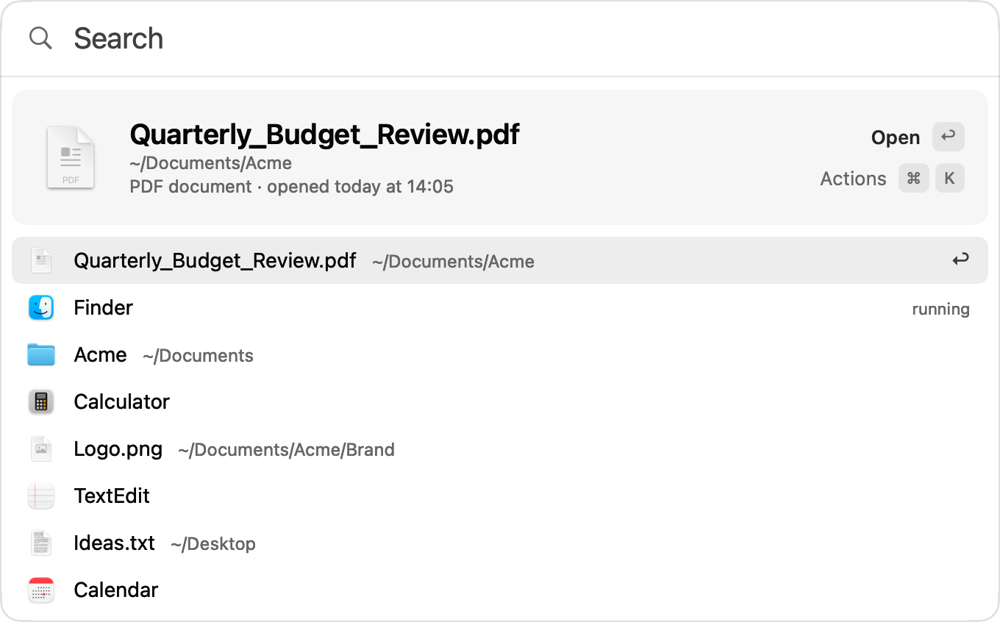
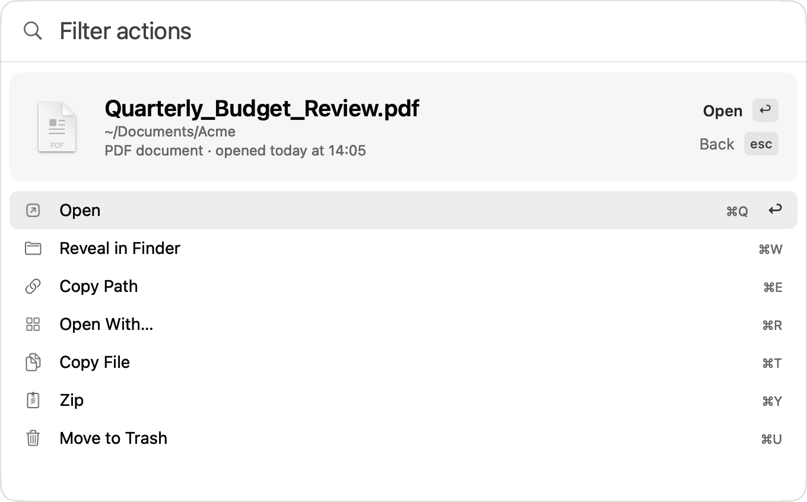
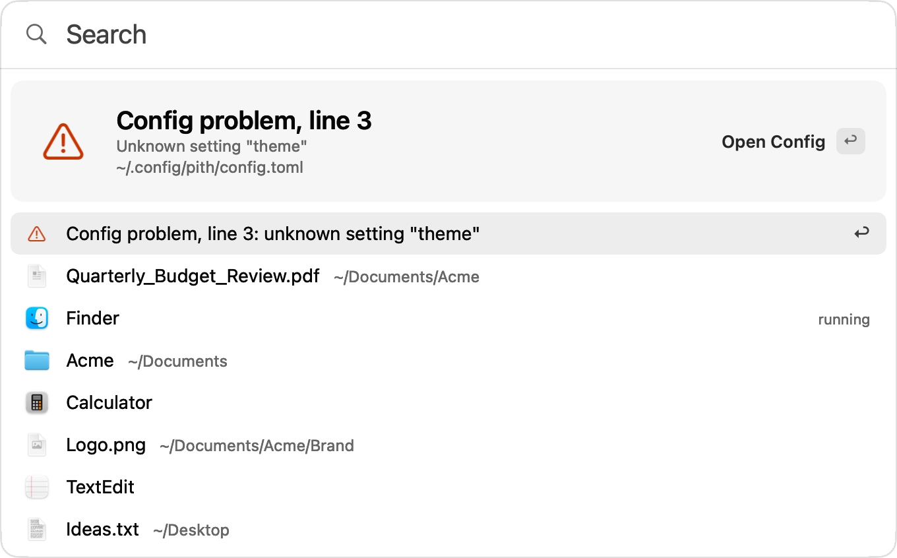
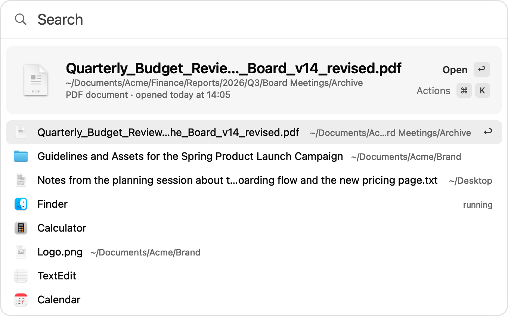

# Pith

**A keyboard-only launcher for macOS that opens in one keystroke and stays out of the way.**

Press ⌘P from any app, type a few letters, press ⏎. Apps, files and folders in one ranked list, with the actions you
need on ⌘K. Native AppKit, always resident, no dependencies, no account, no telemetry.


<p align="center">
  <picture>
    <source media="(prefers-color-scheme: dark)" srcset="docs/snapshots/recent-dark.png">
    
  </picture>
</p>

> Pith: the essential part, and nothing else. It's in active development, and I use it every day.

## Why

I used Raycast, and I think they did a great job. But all I ever needed was the launcher. I don't need most of the
tools, I'm tired of AI being put into everything, and RAM isn't something I can hand out freely to my programs
anymore.

So this is a launcher for people who need a launcher. Not a whole app environment hidden behind one, built mostly to
justify a subscription.

- **Instant.** Built at launch, indexes in memory: ⌘P only shows what's ready.
- **Keyboard only.** The row you want is usually the first.
- **Small.** Native AppKit and Swift, zero dependencies, ~0 % CPU when idle.
- **Private.** No account, no telemetry, no AI, no network (the planned calculator will fetch currency rates).
- **Native.** It follows the system's appearance and is configured with a text file.

## Features

<table>
  <tr>
    <td width="50%" valign="top">
      <picture>
        <source media="(prefers-color-scheme: dark)" srcset="docs/snapshots/search-dark.png">
        
      </picture>
      <p align="center"><sub><b>Type a few letters, press ⏎</b></sub></p>
    </td>
    <td width="50%" valign="top">
      <picture>
        <source media="(prefers-color-scheme: dark)" srcset="docs/snapshots/actions-dark.png">
        
      </picture>
      <p align="center"><sub><b>⌘K</b>: actions for what’s selected</sub></p>
    </td>
  </tr>
  <tr>
    <td width="50%" valign="top">
      <picture>
        <source media="(prefers-color-scheme: dark)" srcset="docs/snapshots/force-quit-dark.png">
        
      </picture>
      <p align="center"><sub><b>Force Quit</b> asks for a second ⏎</sub></p>
    </td>
    <td width="50%" valign="top">
      <picture>
        <source media="(prefers-color-scheme: dark)" srcset="docs/snapshots/problem-dark.png">
        
      </picture>
      <p align="center"><sub><b>Config mistakes</b> show up; ⏎ opens the file</sub></p>
    </td>
  </tr>
  <tr>
    <td width="50%" valign="top">
      <picture>
        <source media="(prefers-color-scheme: dark)" srcset="docs/snapshots/long-names-dark.png">
        
      </picture>
      <p align="center"><sub><b>Long names</b> are cut in the middle</sub></p>
    </td>
    <td width="50%" valign="top">
      <picture>
        <source media="(prefers-color-scheme: dark)" srcset="docs/snapshots/bar-dark.png">
        
      </picture>
      <p align="center"><sub>Or <b>just the search bar</b> until you type</sub></p>
    </td>
  </tr>
</table>

**Also:** Quick Look (Space or ⌘Y) · Zip in the background, with a notification · files indexed in memory and kept
live with FSEvents · empty state of your choice (recent, running apps, or nothing) · starts at login · no Dock or menu
bar icon.

### Keys

| Key | What it does |
|---|---|
| ⌘P | Open or close the launcher, from any app |
| ↑ ↓ or ⌃K ⌃J | Move the selection |
| ⏎ | Open the selected item, or run the selected action |
| ⌘K | Show the selected item's actions, or go back to the search |
| ⎋ | Back one level, or close |
| ⌘Y, or Space with an empty field | Quick Look the selected file |

## Install

Requirements: macOS 26 Tahoe or later, Apple Silicon, and Xcode with Swift 6.4.

```sh
git clone https://github.com/Mediacom99/launcher.git
cd launcher
make install    # builds, copies to ~/Applications and launches
```

Then press ⌘P. The launcher takes ⌘P from every app, including Print; you can change the hotkey in the config.
`make uninstall` quits it and removes it.

## Configuration

Settings live in `~/.config/pith/config.toml`. It's created with commented defaults on first launch, and saved
changes apply right away. A mistake shows up as a row at the top of the launcher, and ⏎ on it opens the file.

```toml
[hotkeys]
launcher = "cmd+p"

[launcher]
empty_state = "recent"      # "recent", "running" or "none"
folders = ["~"]
ignore = [".*", "~/Library", "node_modules", ".build", "*.photoslibrary"]
max_depth = 6

[actions]
terminal = "Ghostty"        # used by "Open in Terminal"

[open_with]
md  = "Visual Studio Code"  # extension or type → app
pdf = "Preview"
```

## Performance

The targets are requirements, and every change is measured against them, not assumed.

| | Target | Measured now |
|---|---|---|
| ⌘P → panel on screen | one frame | 0.4 ms of the app's own work; 23 ms on screen, mostly the window server (being worked on) |
| Keystroke → results | under 5 ms | ~2 ms of work over 111 apps and 35,000+ files; 7–12 ms on screen (being worked on) |
| Idle CPU | ~0 % | ~0 %: no timers or polling, only events |
| Memory | under 50 MB | 39 MB |

How it gets there:
- Nothing blocks the main thread. File I/O, icon rendering and app launches run on background workers.
- Icons are rendered once, at their exact pixel size.
- Rows use fixed frames, and the panel's rounded background is drawn by the compositor, not the CPU.

`make bench` measures the algorithms, `make logs` the live latencies, and `make stats` memory and CPU.

## Roadmap

- [x] Launcher: apps, files, folders, ⌘K actions, Quick Look, Zip
- [x] Stage, the visual design: the tile, compact rows, light and dark
- [ ] Clipboard manager: history with previews, pinned items, search, paste into the previous app, an in-panel text
      editor (⌘⇧V)
- [ ] Calculator: math, units, currency and programmer expressions, inline as the top result
- [ ] On-screen latency down to the targets

## Development

```sh
make            # list every target
make run        # build and launch a dev copy (it takes ⌘P)
make test       # unit and AppKit tests (Swift Testing)
make lint       # swift-format, strict
make bench      # benchmarks, in a release build
make snapshots  # draw the panel's states, light and dark, into docs/snapshots/
```

The code is a Swift package with no Xcode project:
- `Sources/LauncherCore`: the pure logic: scanning, the in-memory index, fuzzy matching, ranking, FSEvents. It never
  imports AppKit.
- `Sources/Launcher`: the AppKit app.

More in the docs:
- [`FEATURES.md`](FEATURES.md): the spec.
- [`docs/ARCHITECTURE.md`](docs/ARCHITECTURE.md): the decision log, threads, icons and measurements.
- [`docs/DESIGN.md`](docs/DESIGN.md): the design system.
- [`docs/PRODUCT.md`](docs/PRODUCT.md): who it's for.
