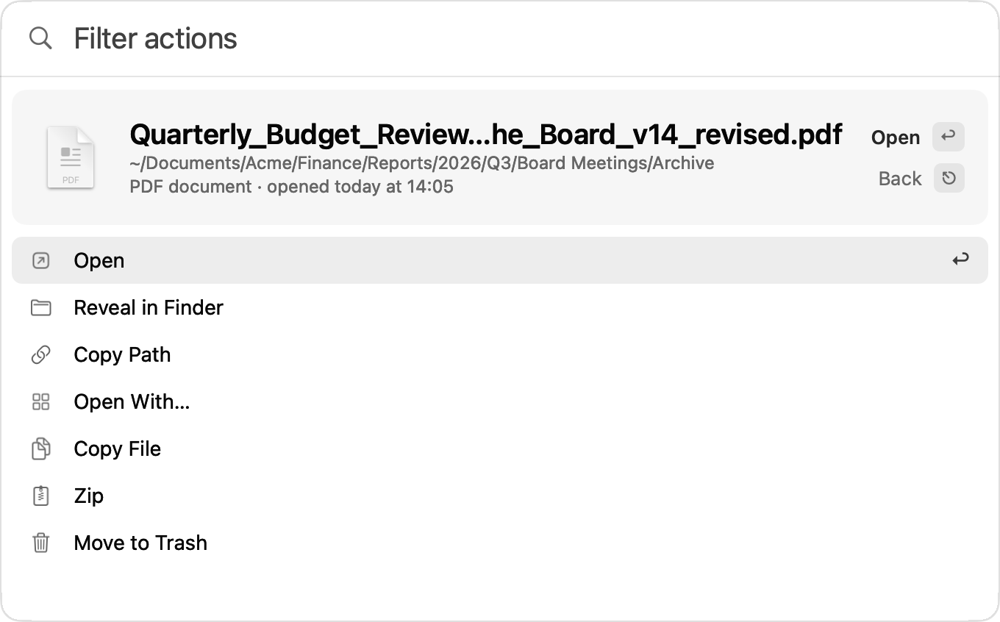
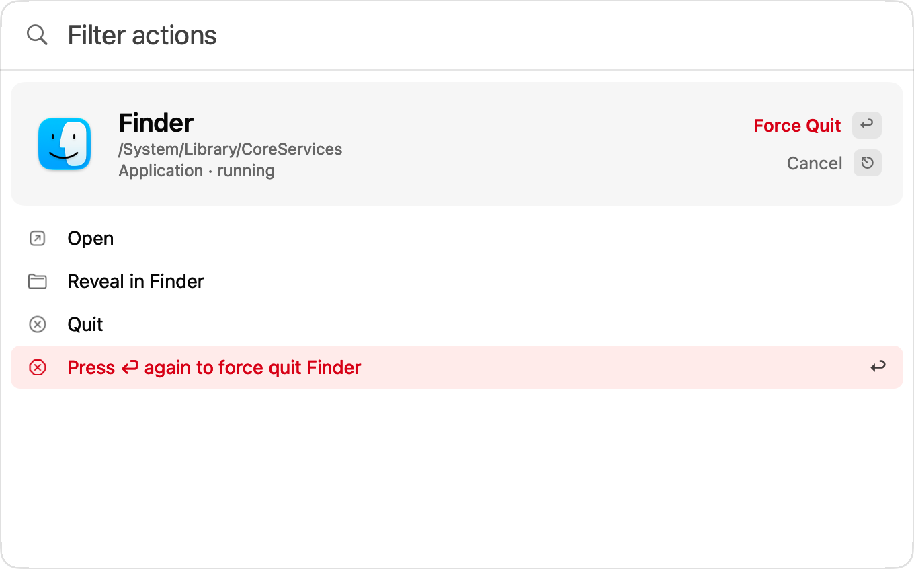

# launcher

**A keyboard-only launcher for macOS that opens in one keystroke and stays out of the way.**

Press ⌘P from any app, type a few letters, press ⏎. Apps, files and folders in one ranked list, with the actions you
need on ⌘K. Native AppKit, always resident, no dependencies, no account, no telemetry.


<p align="center">
  <picture>
    <source media="(prefers-color-scheme: dark)" srcset="docs/snapshots/recent-dark.png">
    
  </picture>
</p>

> `launcher` is a codename. The app is in active development and used daily by its author in place of Raycast.

## Why

Launchers have grown into platforms: extensions, stores, AI, accounts. This one does three things (open anything,
browse the clipboard, calculate) and treats speed and size as the product:

- **Instant.** The window is built at launch and the indexes live in memory. ⌘P only shows what's already prepared.
- **Keyboard only.** Everything is reachable without the mouse. The row you want is usually the first.
- **Small.** Native AppKit and Swift, zero third-party dependencies. When idle it uses no CPU.
- **Private.** No account, no telemetry, no network. The planned calculator will fetch currency rates, and that's all.
- **Native and quiet.** It follows the system's appearance and icon style, and is configured with a text file, not a
  settings window.

## Features

<table>
  <tr>
    <td width="50%">
      <picture>
        <source media="(prefers-color-scheme: dark)" srcset="docs/snapshots/long-actions-dark.png">
        
      </picture>
      <p align="center"><sub>⌘K: the item stays on the tile while you pick an action</sub></p>
    </td>
    <td width="50%">
      <picture>
        <source media="(prefers-color-scheme: dark)" srcset="docs/snapshots/force-quit-dark.png">
        
      </picture>
      <p align="center"><sub>Force Quit asks for a second ⏎</sub></p>
    </td>
  </tr>
</table>

- **One list for everything:** apps, files and folders, ranked together. Matching is fuzzy and word by word, so
  `acme deploy` finds `deploy.sh` under `Acme`. The ranking learns from what you open.
- **The tile:** what ⏎ will act on is always shown large under the search bar: its name, where it is, what it is and
  when you last opened it, with the keys for ⏎ and ⌘K beside it.
- **⌘K actions** for each kind of result:
  - apps: Open, Reveal in Finder, Quit, Force Quit;
  - files: Open, Open With…, Reveal, Copy Path, Copy File, Zip, Move to Trash;
  - folders: the same, plus Open in Terminal.
- **Quick Look:** Space with an empty field, or ⌘Y.
- **Zip** in the background with macOS's own `ditto`. A notification tells you when it's done, and clicking it reveals
  the archive.
- **Empty state of your choice:** what you opened recently, the running apps, or just the search bar.
- **Live file index:** your folders are indexed in memory and kept current with FSEvents. `node_modules`, `.build`,
  hidden files and `~/Library` are skipped.
- **Launcher commands:** Open Config, Reload Config, Quit Launcher. There's no Dock or menu bar icon.
- **Starts at login.** Light and dark mode follow the system.

### Keys

| Key | What it does |
|---|---|
| ⌘P | Open or close the launcher, from any app |
| ↑ ↓ or ⌃K ⌃J | Move the selection |
| ⏎ | Open the selected item, or run the selected action |
| ⌘K | Show the selected item's actions, or go back to the search |
| ⎋ | Back one level, or close |
| ⌘Y, or Space with an empty field | Quick Look the selected file |

## Install

Requirements: macOS 26 Tahoe or later, Apple Silicon, and Xcode with Swift 6.4.

```sh
git clone https://github.com/Mediacom99/launcher.git
cd launcher
make install    # builds, copies to ~/Applications and launches
```

Then press ⌘P. The launcher takes ⌘P from every app, including Print; you can change the hotkey in the config.
`make uninstall` quits it and removes it.

## Configuration

Settings live in `~/.config/launcher/config.toml`. It's created with commented defaults on first launch, and saved
changes apply right away. A mistake shows up as a row at the top of the launcher, and ⏎ on it opens the file.

```toml
[hotkeys]
launcher = "cmd+p"

[launcher]
empty_state = "recent"      # "recent", "running" or "none"
folders = ["~"]
ignore = [".*", "~/Library", "node_modules", ".build", "*.photoslibrary"]
max_depth = 6

[actions]
terminal = "Ghostty"        # used by "Open in Terminal"

[open_with]
md  = "Visual Studio Code"  # extension or type → app
pdf = "Preview"
```

## Performance

The targets are requirements, and every change is measured against them, not assumed.

| | Target | Measured now |
|---|---|---|
| ⌘P → panel on screen | one frame | 0.4 ms of the app's own work; 23 ms on screen, mostly the window server (being worked on) |
| Keystroke → results | under 5 ms | ~2 ms of work over 111 apps and 35,000+ files; 7–12 ms on screen (being worked on) |
| Idle CPU | ~0 % | ~0 %: no timers or polling, only events |
| Memory | under 50 MB | 39 MB |

How it gets there:
- Nothing blocks the main thread. File I/O, icon rendering and app launches run on background workers.
- Icons are rendered once, at their exact pixel size.
- Rows use fixed frames, and the panel's rounded background is drawn by the compositor, not the CPU.

`make bench` measures the algorithms, `make logs` the live latencies, and `make stats` memory and CPU.

## Roadmap

- [x] Launcher: apps, files, folders, ⌘K actions, Quick Look, Zip
- [x] Stage, the visual design: the tile, compact rows, light and dark
- [ ] Clipboard manager: history with previews, pinned items, search, paste into the previous app, an in-panel text
      editor (⌘⇧V)
- [ ] Calculator: math, units, currency and programmer expressions, inline as the top result
- [ ] On-screen latency down to the targets

## Development

```sh
make            # list every target
make run        # build and launch a dev copy (it takes ⌘P)
make test       # unit and AppKit tests (Swift Testing)
make lint       # swift-format, strict
make bench      # benchmarks, in a release build
make snapshots  # draw the panel's states, light and dark, into docs/snapshots/
```

The code is a Swift package with no Xcode project:
- `Sources/LauncherCore`: the pure logic: scanning, the in-memory index, fuzzy matching, ranking, FSEvents. It never
  imports AppKit.
- `Sources/Launcher`: the AppKit app.

More in the docs:
- [`FEATURES.md`](FEATURES.md): the spec.
- [`docs/ARCHITECTURE.md`](docs/ARCHITECTURE.md): the decision log, threads, icons and measurements.
- [`docs/DESIGN.md`](docs/DESIGN.md): the design system.
- [`docs/PRODUCT.md`](docs/PRODUCT.md): who it's for.
